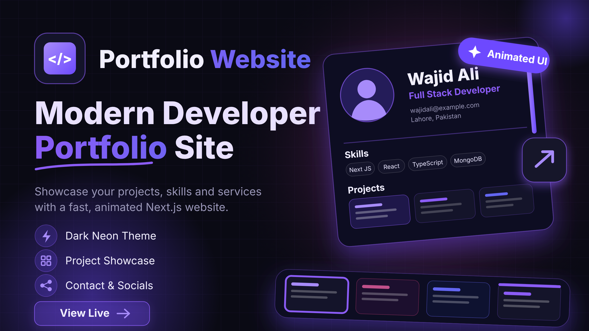

# Wajid Ali | Full Stack Developer Portfolio

A modern, responsive developer portfolio built with Next.js, TypeScript, and Tailwind CSS. Showcasing my skills, projects, education, and experience as a Full Stack Developer specializing in MERN Stack and Next.js.

🌐 **Live Demo:** [View Portfolio](https://devwajidpro.com/)

## ✨ Features

- Modern and responsive UI
- Dark theme with gradient effects
- Interactive animations and custom cursor
- Professional hero section
- About me and education sections
- Skills and technology showcase
- Dynamic project showcase with detailed project pages
- Contact form with EmailJS integration
- Social media profile links
- Optimized for desktop, tablet, and mobile devices

## 🛠️ Tech Stack

| Category | Technologies |
|---|---|
| Framework | Next.js, React |
| Language | TypeScript, JavaScript |
| Styling | Tailwind CSS |
| Icons | Lucide React, React Icons |
| Email Service | EmailJS |
| Deployment | Vercel |

## 📸 Portfolio Preview




## 🚀 Getting Started

### 1. Clone the Repository

```bash
git clone https://github.com/devwajidpro/portfolio.git
```

### 2. Navigate to the Project

```bash
cd portfolio
```

### 3. Install Dependencies

```bash
npm install
```

### 4. Configure Environment Variables

Create a `.env.local` file in the root directory:

```env
NEXT_PUBLIC_EMAILJS_SERVICE_ID=your_service_id
NEXT_PUBLIC_EMAILJS_TEMPLATE_ID=your_template_id
NEXT_PUBLIC_EMAILJS_PUBLIC_KEY=your_public_key
```

### 5. Run Development Server

```bash
npm run dev
```

Open [http://localhost:3000](http://localhost:3000) in your browser.

## 📂 Project Structure

```text
portfolio/
├── public/
│   └── images/
├── src/
│   ├── app/
│   │   ├── (app)/
│   │   ├── project/
│   │   ├── layout.tsx
│   │   └── globals.css
│   └── components/
│       ├── Navbar.tsx
│       ├── Footer.tsx
│       ├── CustomCursor.tsx
│       ├── BackgroundEffect.tsx
│       └── ContactSection.tsx
├── .env.local
├── package.json
└── README.md
```

## 👨‍💻 About Me

I'm Wajid Ali, a Full Stack Developer passionate about building modern, scalable, and user-focused web applications.

I specialize in MERN Stack, Next.js, React, Node.js, and modern web technologies.

## 📬 Connect With Me

- **GitHub:** [@devwajidpro](https://github.com/devwajidpro)
- **LinkedIn:** [Wajid Ali](https://linkedin.com/in/devwajidpro)
- **Portfolio:** [devwajidpro.vercel.app](https://devwajidpro.com)

---

⭐ If you like this project, consider giving it a star!

**Built with ❤️ by Wajid Ali**